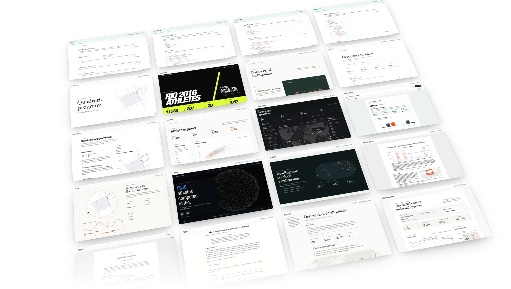
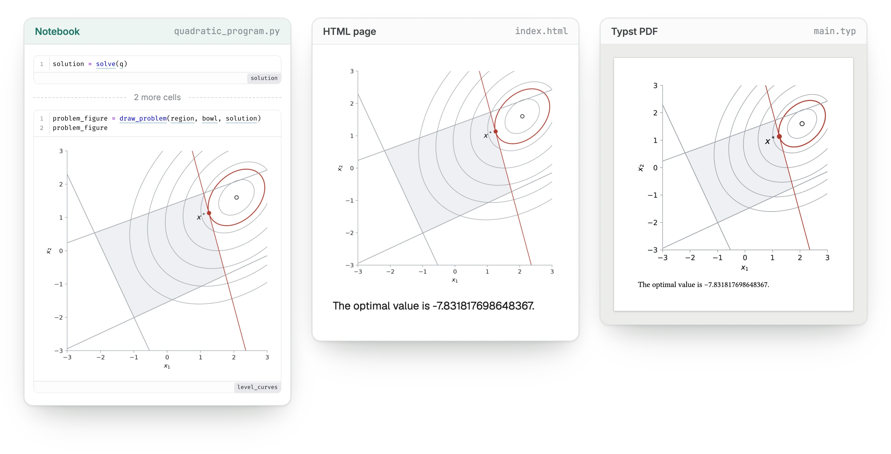
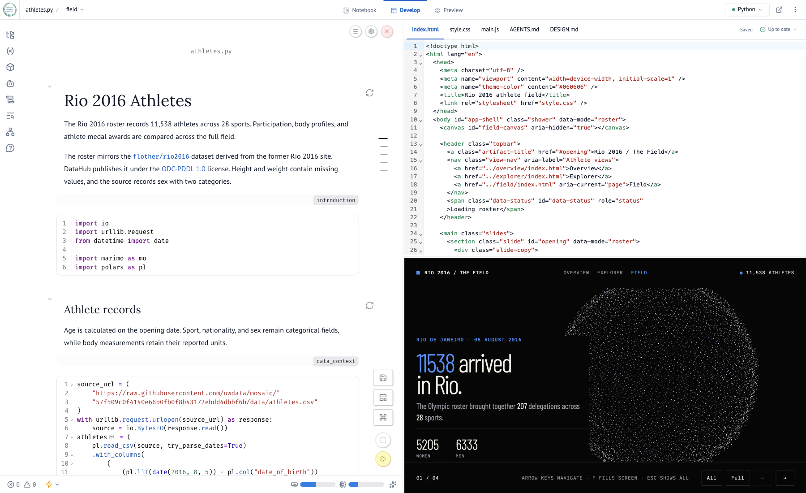

<p align="center">
  <a href="https://marimo-team.github.io/marimo-studio/">
    <picture>
      <source media="(prefers-color-scheme: dark)" srcset="https://marimo-team.github.io/marimo-studio/brand/marimo-studio-lockup-horizontal-dark.svg">
      
    </picture>
  </a>
</p>

<p align="center">
  <a href="https://marimo-team.github.io/marimo-studio/examples/">
    <picture>
      <source media="(prefers-color-scheme: dark)" srcset="apps/docs/public/showcase/marimo-studio-wall-dark.webp">
      
    </picture>
  </a>
</p>

<p align="center">
  <a href="https://github.com/marimo-team/marimo-studio/actions/workflows/ci.yml"></a>
  <a href="https://pypi.org/project/marimo-studio/"></a>
  <a href="https://pypi.org/project/marimo-studio/"></a>
</p>

marimo-studio builds views of a [marimo](https://marimo.io/) notebook: web
pages, slide decks, and typeset PDF documents that place the notebook's
results by name. A view can place a cell with its controls, a rendered output
such as a chart, or a value such as a number or a table. The notebook keeps the
data and the computation. Each view keeps its own source in a folder beside the
notebook, in the format its audience needs. Studio's starters create HTML
pages, React or Svelte apps, Reveal.js decks, Observable notebooks, Quarto
articles, and Typst or LaTeX PDFs. A
[view provider](https://marimo-team.github.io/marimo-studio/guide/view-providers),
a Python package, adds any other framework, template, or build tool.

Pages stay live, so changing a control updates every result that depends on
it. Documents typeset again with the new values. Every result traces back to
the notebook cell that computed it.

> [!NOTE]
> Studio is experimental and changing rapidly. Pin `marimo-studio` in saved
> projects.

## Example

Two cells from a notebook that solves an optimization problem:

```python
@app.cell
def solution(q, solve):
    solution = solve(q)
    return (solution,)


@app.cell
def level_curves(bowl, draw_problem, region, solution):
    problem_figure = draw_problem(region, bowl, solution)
    problem_figure
    return (problem_figure,)
```

An HTML page places the figure and the optimal value:

```html
<marimo-output value="problem_figure"></marimo-output>
<p>The optimal value is <strong mo-value="solution.value"></strong>.</p>
```

A Typst report places the same two results in a PDF:

```typst
#import "marimo.typ": marimo_output, marimo_value

#marimo_output("problem_figure", width: 100%)
The optimal value is #marimo_value("solution.value", default: 0).
```

The notebook computes both results, and each view shows them in its own format:

<p align="center">
  <picture>
    <source media="(prefers-color-scheme: dark)" srcset="apps/docs/public/figures/output-value-wide-dark.webp">
    
  </picture>
</p>

The page shows the figure as marimo renders it. The PDF draws it as a vector
graphic at the width the Typst source places it.

[What is Studio?](https://marimo-team.github.io/marimo-studio/what-is-studio) explains the model, and the
[Quadratic programs](https://marimo-team.github.io/marimo-studio/examples/quadratic-programs) example shows both
views next to the notebook.

## Get started

Paste this request into Claude Code, Codex, or another terminal agent:

```text
Run `uvx --with marimo-studio agent-plugins read marimo-studio` and create
a scrollytelling report and a slide deck explaining calculus basics.
```

The agent reads the instructions Studio ships for coding agents, starts a
notebook with Studio, writes the calculus in Python cells, then builds both
views and shows them beside the notebook. [uv](https://docs.astral.sh/uv/)
supplies `uvx`.

To work by hand, open a notebook with Studio:

```console
uvx --with marimo-studio marimo edit analysis.py --sandbox --watch
```

Click **Add view** in the toolbar, choose **HTML document**, and create the
view. Notebook and Preview open side by side, and saving view source rebuilds
Preview.



[Getting started](https://marimo-team.github.io/marimo-studio/guide/getting-started) walks through a first view,
and [Author with a coding agent](https://marimo-team.github.io/marimo-studio/guide/coding-agents) covers working
with an agent.

## Examples

Each example notebook backs four views:

- [Quadratic programs](https://marimo-team.github.io/marimo-studio/examples/quadratic-programs): a Reveal.js
  lecture, an HTML explainer, a Svelte and D3 lab, and a Typst report.
- [Rio 2016 athletes](https://marimo-team.github.io/marimo-studio/examples/athletes): an HTML overview, a Mosaic
  explorer, a Three.js presentation, and a Quarto paper.
- [Earthquake watch](https://marimo-team.github.io/marimo-studio/examples/earthquakes): an Observable Plot story,
  a MapLibre operations map, a Reveal.js briefing, and a Quarto bulletin.
- [Building occupancy](https://marimo-team.github.io/marimo-studio/examples/occupancy): a Notebook Kit monitor, a
  PDF field report, a LaTeX journal paper, and a Recharts model review.

D3, Mosaic, Three.js, MapLibre, Observable Plot, and Recharts run in the
views' own code and draw the values those views read from the notebook. A
page can load any JavaScript library the same way.

## Run or export a view

Serve the notebook's views as a live Python app:

```console
uvx --with marimo-studio marimo run analysis.py --sandbox
```

Or export the `report` view as a static site:

```console
uvx marimo-studio view export report --target analysis.py --output dist/report
```

The export runs the notebook on your machine, prepares results for each input
state the view lists, and leaves the notebook source out of the site. Views can also
run Python in the visitor's browser.
[Run or export a view](https://marimo-team.github.io/marimo-studio/guide/run-and-share) compares the options.

## Documentation

[Guide](https://marimo-team.github.io/marimo-studio/guide/) ·
[Examples](https://marimo-team.github.io/marimo-studio/examples/) ·
[Reference](https://marimo-team.github.io/marimo-studio/reference/) ·
[Troubleshooting](https://marimo-team.github.io/marimo-studio/guide/troubleshooting) ·
[Security](SECURITY.md) · [Contributing](CONTRIBUTING.md)

## License

[Apache License 2.0](LICENSE).
